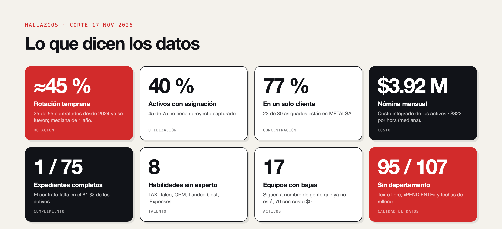

<p align="center">
  
</p>

<p align="center">
  
  
  
  
  
</p>

<p align="center">
  <a href="#de-qué-trata"><b>De qué trata</b></a> ·
  <a href="#lo-que-dicen-los-datos"><b>Hallazgos</b></a> ·
  <a href="#cómo-están-conectados-los-datos"><b>Mapa</b></a> ·
  <a href="#el-modelo-que-proponemos"><b>Modelo</b></a> ·
  <a href="#qué-sigue-preguntas-e-indicadores"><b>Indicadores</b></a> ·
  <a href="#cómo-correrlo"><b>Cómo correrlo</b></a>
</p>

<br>

## De qué trata

**OT Consulting** es una consultora mexicana de TI e IA que implementa Oracle EBS, Oracle Cloud y NetSuite. En una consultora el producto es la gente: se venden **horas, conocimiento y certificaciones**. Por eso Recursos Humanos es un área estratégica.

RH administra a todos los colaboradores en un sistema propio (una PWA en Firebase) con 7 módulos: colaboradores, asignaciones, clientes, matriz de habilidades, catálogo de habilidades, departamentos e inventario de equipo.

Este repo documenta la **exploración de esas 7 fuentes, archivo por archivo y columna por columna**. A partir de ella propone un modelo de datos, reglas de negocio y los indicadores que RH necesita para decidir con datos y no solo con la experiencia.

> [!NOTE]
> Es un proyecto académico (reto con socio formador). El repo es público, así que **no incluye datos individuales**: ver [Privacidad](#privacidad).

<br>

## Lo que dicen los datos

<p align="center">
  
</p>

**En una frase:** el sistema guarda los datos, pero no los ordena. Por eso hoy RH no puede contestar con datos **por qué se va la gente** ni **cuánta de su plantilla está facturando**.

<details>
<summary><b>Ver todos los hallazgos por tema</b></summary>
<br>

**Rotación**
- 32 bajas de 107 registros (30 %). De los 55 contratados desde 2024 ya se fueron 25.
- Quienes se van duran poco: mediana de **1 año**.
- El esquema de nómina MAGNESON-SINDICATO concentra 10 de las 32 bajas.
- No se registra la causa de baja.

**Asignaciones y utilización**
- Solo 30 de 75 activos tienen un proyecto capturado.
- 23 de los 30 asignados están en un solo cliente.
- No hay horas, tarifas ni ingreso por proyecto.

**Nómina**
- $3.92 M al mes de costo integrado. El 66 % del sueldo neto se paga por asimilados o sindicato.
- 10 esquemas de nómina distintos. Las fórmulas de sueldo cuadran al 100 %.

**Habilidades**
- 28 activos sin matriz de habilidades.
- 8 habilidades sin ningún experto.
- Solo 12 personas con certificación Oracle, y sin fecha de vencimiento.

**Cumplimiento y activos**
- 1 de 75 expedientes completos.
- 70 equipos con costo $0, 32 sin asignar y 17 a nombre de personas dadas de baja.

**Calidad de datos**
- 95 de 107 sin departamento y 29 activos con puesto «PENDIENTE».
- Fechas de relleno `1990-01-01` y la palabra «Indefinido» dentro de columnas de fecha.
- Activos se une al colaborador por nombre y no por ID.

</details>

<br>

## Cómo están conectados los datos

Así se relacionan hoy las 7 tablas. Las líneas sólidas son uniones por ID (confiables); las punteadas en rojo son uniones por texto (frágiles).

<p align="center">
  
</p>

| Archivo | Filas | Qué guarda |
|---|:-:|---|
| `Catalogo_Colaboradores` | 107 | Expediente de cada persona: estatus, puesto, nómina, sueldos, seguros y documentos |
| `Asignaciones_Colaboradores` | 31 | Quién está en qué cliente y proyecto |
| `Catalogo_Clientes` | 12 | 8 clientes con sus 12 proyectos |
| `Catalogo_Activos` | 123 | Inventario de equipo de cómputo |
| `Matriz_Habilidades` | 54 | Nivel de cada colaborador en 71 habilidades |
| `Catalogo_Habilidades` | 71 | Lista de habilidades técnicas y blandas |
| `Catalogo_Departamentos` | 6 | Áreas de la empresa |

<br>

## El modelo que proponemos

**14 tablas unidas por ID**: 7 nuevas y 7 ajustadas. En rojo, cada tabla indica el error del modelo actual que corrige.

<p align="center">
  
</p>

<details>
<summary><b>Ver las reglas de negocio principales</b></summary>
<br>

1. Todas las tablas se unen por ID, nunca por nombre.
2. Puesto, departamento, nómina, ciudad, marca y causa de baja se eligen de una lista, no se escriben.
3. No se permiten «PENDIENTE» ni fechas de relleno; si un dato no se conoce, queda vacío.
4. Un activo debe tener puesto, departamento, esquema de nómina y sueldo mayor a $0.
5. Toda baja tiene fecha, tipo y causa.
6. Un consultor puede estar en varios proyectos mientras su dedicación total no pase de 100 %.
7. Un activo sin asignación vigente está «en banca».
8. Costo por hora = sueldo integrado / 160.
9. Al dar de baja a alguien se recupera su equipo.
10. Las certificaciones tienen fecha de vencimiento y las habilidades se reevalúan cada año.

Las 20 reglas completas están en el [documento](docs/OT_Consulting_Etapa1_Documento_Completo.pdf).

</details>

<br>

## Qué sigue: preguntas e indicadores

Planteamos **25 preguntas detonadoras** y **15 indicadores** para que RH tome decisiones con datos. Algunos:

| Indicador | Fórmula | Meta sugerida |
|---|---|:-:|
| Rotación | Bajas / headcount promedio | < 15 % anual |
| Rotación temprana | Bajas con menos de 12 meses / altas | < 20 % |
| Utilización | Horas facturables / horas disponibles | ≥ 80 % |
| % en banca | Activos sin asignación / headcount | < 10 % |
| Concentración por cliente | Asignados en el cliente principal / total | < 40 % |
| Margen por proyecto | (Ingreso − costo de personal) / ingreso | ≥ 30 % |
| Certificaciones vigentes | No vencidas / total | ≥ 90 % |
| Expediente completo | Activos con expediente completo / headcount | 100 % |

<sub>Las metas son una propuesta del equipo y se validarán con el socio formador.</sub>

<details>
<summary><b>Ver ejemplos de preguntas detonadoras</b></summary>
<br>

- ¿Qué consultores terminarán pronto una asignación (30, 60 y 90 días)?
- ¿Cuál es el costo por hora de cada consultor, derivado de su salario mensual?
- ¿Qué perfil tienen quienes se van en su primer año?
- ¿Qué consultores en banca tienen las habilidades que pide un proyecto nuevo?
- ¿Qué certificaciones vencen en los próximos 90 días?
- ¿Cuánto vale el equipo que no se ha recuperado de las bajas?

</details>

<br>

## Qué hay en el repo

```
otconsultingdocumentacion/
├── docs/
│   ├── OT_Consulting_Etapa1_Documento_Completo.pdf   documento entregable completo
│   ├── exploracion-datos.md                          hallazgos de la exploración
│   └── avance-reto-etapa-1.md                        contexto de la empresa y del área
├── notebooks/
│   └── Exploracion_OTC_FrancoVarela.ipynb            exploración en Python + SQL
├── img/                                              banner, hallazgos, mapa y modelo
├── datos/README.md                                   los Excel originales no se publican
└── requirements.txt
```

**El [documento completo](docs/OT_Consulting_Etapa1_Documento_Completo.pdf)** incluye: resumen ejecutivo · exploración · objeto de estudio · metadata · errores y modelo sugerido · reglas de negocio · preguntas detonadoras · métricas · indicadores · atributos adicionales · anexo con el notebook.

<br>

## Cómo correrlo

Los Excel del socio formador no vienen en el repo. Si los tienes, ponlos en `datos/` y corre:

```bash
python -m venv .venv && source .venv/bin/activate
pip install -r requirements.txt
jupyter notebook notebooks/Exploracion_OTC_FrancoVarela.ipynb
```

El notebook carga los 7 archivos y hace un perfil de cada columna (tipo, nulos, únicos, ejemplos y rangos). Valida con SQL la integridad entre tablas, calcula los primeros indicadores y cierra cada sección con sus respuestas en markdown.

<br>

## Privacidad

> [!IMPORTANT]
> Este repo **no publica datos individuales**. Los Excel fuente se quedan fuera (`.gitignore`). En el notebook se ocultan los valores de las columnas con datos personales, sueldos y contactos de clientes. Solo se muestran conteos, totales y gráficas agregadas. Los RFC, CURP y NSS ya venían anonimizados por el socio formador.

<br>

---

<p align="center">
  <b>Franco Varela Villegas</b><br>
  <a href="https://github.com/Francovarelav">@Francovarelav</a><br>
  <sub>Hecho con el equipo del reto: Emilio Ogaz · Angelica Velez · Melissa Esparza · José Fernando Munguía · noviembre de 2026</sub>
</p>
