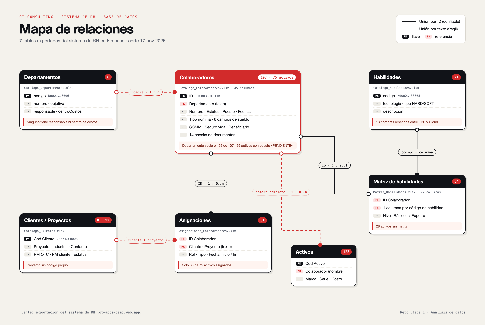
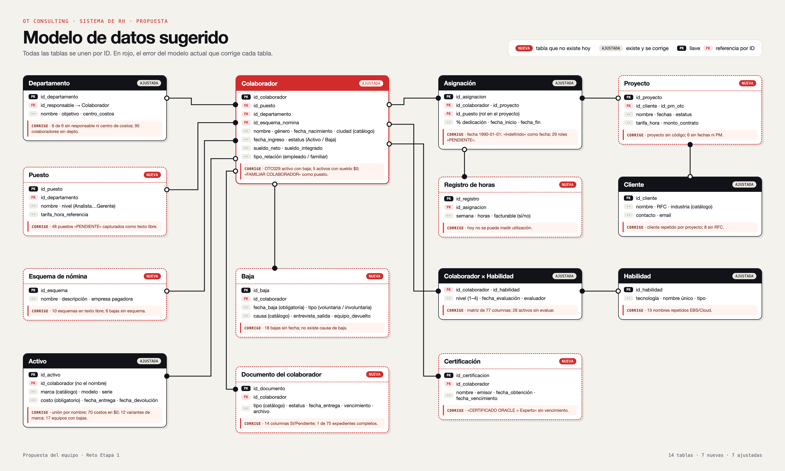

# OT Consulting · Analítica de datos de Recursos Humanos

> Exploración, documentación y propuesta de modelo de datos para el sistema de RH de **OT Consulting**, una consultora mexicana de TI e IA (Oracle EBS, Oracle Cloud y NetSuite).
> Reto académico · Etapa 1: Justificación y planeación.

<p align="center">
  
</p>

---

## De qué trata

En una consultora, el producto es la gente: se venden horas, conocimiento y certificaciones. OT Consulting maneja a sus colaboradores en un sistema propio (una PWA en Firebase) con módulos de colaboradores, asignaciones, clientes, matriz de habilidades, departamentos e inventario de equipo.

Este repositorio documenta la exploración **archivo por archivo y columna por columna** de las 7 fuentes que exporta ese sistema. Con base en eso propone:

- un modelo de datos que se puede analizar,
- las reglas de negocio para capturar bien los datos,
- las preguntas, métricas e indicadores que RH necesita para decidir con datos.

## Hallazgos en números

| | |
|---|---|
| **107** colaboradores registrados | 75 activos · 32 bajas |
| **≈45 %** de rotación temprana | de los 55 contratados desde 2024 ya se fueron 25, con una mediana de **1 año** en la empresa |
| **40 %** de los activos con asignación | 45 de 75 no tienen un proyecto capturado |
| **77 %** de los asignados en un solo cliente | 23 de 30 están en METALSA |
| **$3.92 M** de nómina mensual integrada | costo por hora mediano estimado de **$322** |
| **1 de 75** expedientes completos | el contrato falta en el 81 % de los activos |
| **8** habilidades sin ningún experto | TAX, Taleo, OPM, Landed Cost, iExpenses… |
| **17** equipos a nombre de personas dadas de baja | además, 70 equipos tienen costo capturado de $0 |

**La conclusión:** el sistema guarda los datos, pero no los ordena. Hay campos de texto libre, valores «PENDIENTE», fechas de relleno (`1990-01-01`) y tablas unidas por nombre en lugar de ID. Además, faltan datos clave: la causa de baja, las horas por proyecto, las tarifas y el vencimiento de las certificaciones. Por eso hoy RH no puede contestar con datos por qué se va la gente ni cuánta de su plantilla está facturando.

## Modelo de datos sugerido

14 tablas, todas unidas por ID: **7 nuevas** y **7 ajustadas**. Cada tabla dice qué error del modelo actual corrige.

<p align="center">
  
</p>

## Qué hay en el repositorio

```
otconsultingdocumentacion/
├── README.md
├── docs/
│   ├── OT_Consulting_Etapa1_Documento_Completo.pdf   ← documento entregable (resumen, metadata,
│   │                                                    errores, reglas, preguntas, métricas,
│   │                                                    indicadores y anexo con el notebook)
│   ├── exploracion-datos.md                          ← hallazgos de la exploración
│   └── avance-reto-etapa-1.md                        ← contexto de la empresa y del área
├── notebooks/
│   └── Exploracion_OTC_FrancoVarela.ipynb            ← exploración en Python + SQL (sqlite3)
├── img/
│   ├── mapa-relaciones.png                           ← cómo se relacionan hoy las 7 tablas
│   └── modelo-sugerido.png                           ← modelo propuesto
├── datos/
│   └── README.md                                     ← los Excel originales no se publican
└── requirements.txt
```

## El documento

[`docs/OT_Consulting_Etapa1_Documento_Completo.pdf`](docs/OT_Consulting_Etapa1_Documento_Completo.pdf) contiene:

1. **Resumen ejecutivo**
2. **Exploración de las fuentes**, con el mapa de relaciones
3. **Objeto de estudio:** el ciclo de vida del colaborador y las tres preguntas que hoy no se pueden responder
4. **Metadata** de cada archivo y campo
5. **Errores, faltantes e inconsistencias**, más el modelo sugerido
6. **20 reglas de negocio.** Por ejemplo: un consultor puede estar en varios proyectos mientras la suma de su dedicación no pase de 100 %, y el costo por hora es el sueldo integrado entre 160
7. **25 preguntas detonadoras** sobre rotación, utilización, costo, habilidades y cumplimiento
8. **Métricas** que ya existen y las que hay que agregar
9. **15 indicadores**, cada uno con fórmula, meta sugerida y frecuencia
10. **Atributos adicionales** que se necesitan capturar
11. **Anexo** con el notebook ejecutado

## Cómo correr el notebook

Los Excel del socio formador **no están en el repositorio** (ver [`datos/README.md`](datos/README.md)). Si los tienes, ponlos en `datos/` y corre:

```bash
python -m venv .venv && source .venv/bin/activate
pip install -r requirements.txt
jupyter notebook notebooks/Exploracion_OTC_FrancoVarela.ipynb
```

El notebook carga los 7 archivos y hace un perfil de cada columna: tipo, nulos, únicos, ejemplos y rangos. Valida con SQL la integridad entre tablas, calcula los primeros indicadores (rotación, nómina, banca, habilidades, expedientes y activos) y cierra cada sección con sus respuestas en markdown.

## Privacidad

Este repositorio es público y por eso **no incluye datos individuales**. Los archivos fuente se quedan fuera. En el notebook se ocultan los valores de las columnas con datos personales, sueldos y contactos de clientes, así que solo se publican conteos, totales y gráficas agregadas. Los datos personales (RFC, CURP, NSS) ya venían anonimizados por el socio formador.

## Herramientas

Python · pandas · matplotlib · SQLite · Jupyter

---

**Franco Varela Villegas** · [@Francovarelav](https://github.com/Francovarelav)
Proyecto realizado con el equipo del reto (Emilio Ogaz, Angelica Velez, Melissa Esparza y José Fernando Munguía) para OT Consulting, noviembre de 2026.
